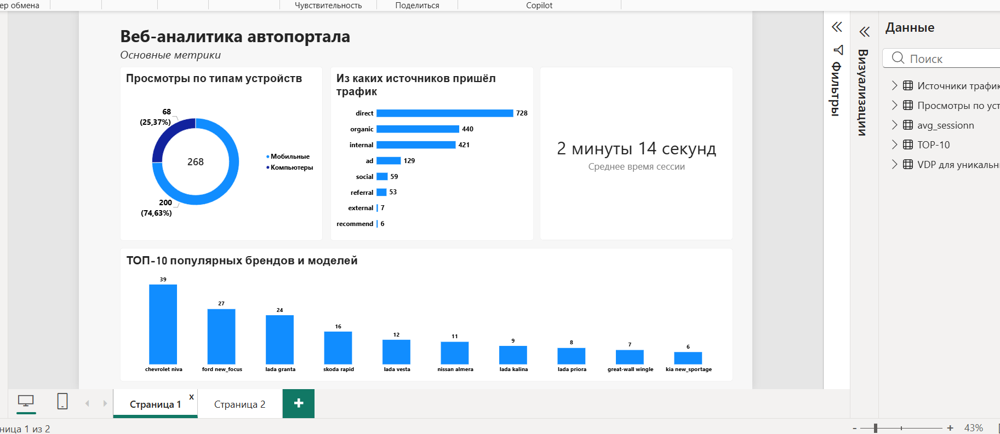
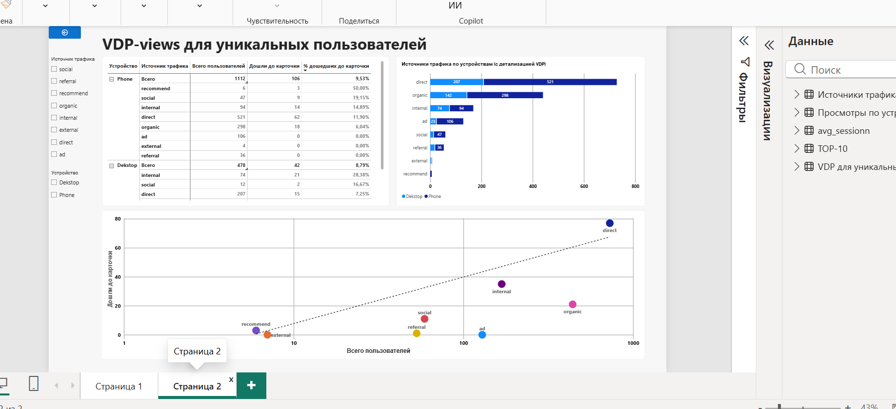
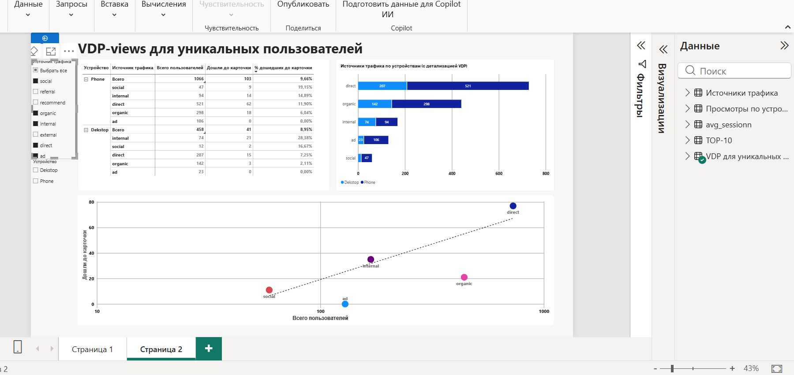

# ТЕСТОВОЕ ЗАДАНИЕ НА ПОЗИЦИЮ DATA ANALYST

**Выполнил:** Беков Дмитрий Александрович

---

## ЧАСТЬ 1. SQL-запросы

### 1. Топ-10 самых популярных брендов и моделей по просмотрам

```sql
WITH parsed_urls AS (
  SELECT
    LOWER(CAST(SPLIT(ym_pv_URL, '/')[SAFE_OFFSET(4)] AS STRING)) AS brand,
    LOWER(CAST(SPLIT(ym_pv_URL, '/')[SAFE_OFFSET(5)] AS STRING)) AS model
  FROM 
    `testwork-511819.toretto_car.logs`
  WHERE 
    ARRAY_LENGTH(SPLIT(ym_pv_URL, '/')) = 7
    AND SPLIT(ym_pv_URL, '/')[SAFE_OFFSET(3)] IN ('new', 'used')
    AND SPLIT(ym_pv_URL, '/')[SAFE_OFFSET(4)] NOT LIKE '%?%'
    AND SPLIT(ym_pv_URL, '/')[SAFE_OFFSET(5)] NOT LIKE '%?%'
)
SELECT
  CONCAT(brand, ' ', model) AS auto,
  COUNT(*) AS views
FROM 
  parsed_urls
GROUP BY 
  auto
ORDER BY 
  views DESC
LIMIT 10;
```
### 2. Средняя длина сессии

```sql
WITH time_diffs AS (
  SELECT
    ym_pv_clientID,
    ym_pv_dateTime AS event_time,
    LAG(ym_pv_dateTime) OVER (
      PARTITION BY CAST(ym_pv_clientID AS STRING)
      ORDER BY ym_pv_dateTime
    ) AS prev_event_time
  FROM 
    `testwork-511819.toretto_car.logs`
),

session_flags AS (
  SELECT
    ym_pv_clientID,
    event_time,
    CASE
      WHEN prev_event_time IS NULL THEN 1
      WHEN TIMESTAMP_DIFF(event_time, prev_event_time, SECOND) > 1800 THEN 1
      ELSE 0
    END AS is_new_session
  FROM 
    time_diffs
),

session_ids AS (
  SELECT
    ym_pv_clientID,
    event_time,
    SUM(is_new_session) OVER (
      PARTITION BY CAST(ym_pv_clientID AS STRING)
      ORDER BY event_time
    ) AS session_num
  FROM 
    session_flags
),

session_durations AS (
  SELECT
    ym_pv_clientID,
    session_num,
    TIMESTAMP_DIFF(MAX(event_time), MIN(event_time), SECOND) AS duration_seconds
  FROM 
    session_ids
  GROUP BY 
    ym_pv_clientID, 
    session_num
)

SELECT
  FORMAT('%d мин %d сек',
    CAST(FLOOR(AVG(duration_seconds) / 60) AS INT64),
    MOD(CAST(ROUND(AVG(duration_seconds)) AS INT64), 60)
  ) AS avg_session_time
FROM 
  session_durations;
```

### 3. Просмотры страниц автомобилей (VDP) по устройствам

```sql
WITH split_urls AS (
  SELECT
    ym_pv_deviceCategory,
    SPLIT(ym_pv_URL, '/') AS valid_url
  FROM 
    `testwork-511819.toretto_car.logs`
  WHERE 
    ym_pv_deviceCategory IN (1, 2, 3)
)

SELECT
  CASE
    WHEN ym_pv_deviceCategory = 1 THEN 'Компьютеры (Desktop)'
    WHEN ym_pv_deviceCategory IN (2, 3) THEN 'Мобильные (Mobile)'
  END AS device_type,
  COUNT(*) AS vdp_views
FROM 
  split_urls
WHERE 
  ARRAY_LENGTH(valid_url) = 7
  AND valid_url[SAFE_OFFSET(3)] IN ('new', 'used')
  AND valid_url[SAFE_OFFSET(4)] NOT LIKE '%?%'
  AND valid_url[SAFE_OFFSET(5)] NOT LIKE '%?%'
GROUP BY 
  device_type
ORDER BY 
  vdp_views DESC;
```
### 4. Источники трафика клиентов
```sql
SELECT
  COUNT(DISTINCT(CAST(ym_pv_clientID AS STRING))) AS user,
  ym_pv_lastTrafficSource
FROM 
  `testwork-511819.toretto_car.logs`
GROUP BY 
  ym_pv_lastTrafficSource;
```
### 5. Отношение VDP views ко всем просмотрам (по уникальным пользователям)

```sql
WITH views_unique_vdp AS (
  SELECT
    CASE
      WHEN ym_pv_deviceCategory = 1 THEN 'Desktop'
      WHEN ym_pv_deviceCategory IN (2, 3) THEN 'Phone'
    END AS device,
    ym_pv_lastTrafficSource,
    COUNT(DISTINCT CAST(ym_pv_clientID AS STRING)) AS unique_user
  FROM 
    `testwork-511819.toretto_car.logs`
  WHERE 
    ARRAY_LENGTH(SPLIT(ym_pv_URL, '/')) = 7
    AND SPLIT(ym_pv_URL, '/')[SAFE_OFFSET(3)] IN ('new', 'used')
    AND SPLIT(ym_pv_URL, '/')[SAFE_OFFSET(4)] NOT LIKE '%?%'
    AND SPLIT(ym_pv_URL, '/')[SAFE_OFFSET(5)] NOT LIKE '%?%'
  GROUP BY 
    ym_pv_lastTrafficSource, device
),

views_total_vdp AS (
  SELECT
    CASE
      WHEN ym_pv_deviceCategory = 1 THEN 'Desktop'
      WHEN ym_pv_deviceCategory IN (2, 3) THEN 'Phone'
    END AS device,
    ym_pv_lastTrafficSource,
    COUNT(DISTINCT CAST(ym_pv_clientID AS STRING)) AS total_count
  FROM 
    `testwork-511819.toretto_car.logs`
  WHERE 
    ym_pv_URL LIKE 'http%' -- исключаем url goal
  GROUP BY 
    ym_pv_lastTrafficSource, device
)

SELECT
  vt.device AS device,
  vt.ym_pv_lastTrafficSource AS TrafficSource,
  vt.total_count AS total_views,
  IFNULL(vu.unique_user, 0) AS VDP_views,
  ROUND(SAFE_DIVIDE(IFNULL(vu.unique_user, 0) * 100.0, vt.total_count), 2) AS VDP_percent
FROM 
  views_total_vdp AS vt
LEFT JOIN 
  views_unique_vdp AS vu 
  ON vu.ym_pv_lastTrafficSource = vt.ym_pv_lastTrafficSource
  AND vu.device = vt.device
ORDER BY 
  device, TrafficSource;
```
### 6. Описание столбца ym_pv_notBounce
Столбец ym_pv_notBounce является флагом и в зависимости от выполнения совокупности действий(или от их отсутствия) в текущей сессии обозначается 1 или 0.

## ЧАСТЬ 2. Визуализация и выводы

### Дашборд (Power BI)

Скриншоты страниц дашборда 




### Основные выводы

Общие метрики:

    Мобильный трафик доминирует: Около 75% пользователей заходят на портал с мобильных устройств. Сайт должен иметь безупречный адаптив и высокую скорость загрузки на смартфонах, иначе есть риск потери большой части аудитории.

    Популярность моделей: В ТОП-10 по просмотрам лидируют автомобили отечественного автопрома (Chevrolet Niva, Lada Granta), а также бюджетные иномарки (Ford Focus, Skoda Rapid).

    Источники трафика: Основной объем визитов приносят direct (728), organic (440) и internal (421). При этом внутренний трафик (internal) имеет самую высокую долю десктопных пользователей (около 44% визитов внутри этого канала).

VDP-views (Конверсия в карточку):

    Лидеры по эффективности: Наивысшую конверсию в просмотр карточки демонстрируют internal (28,38%) и social (16,67%). Если смотреть на абсолютные цифры, то direct и internal приводят больше всего людей к целевому действию.

    Аномалия с organic: Несмотря на большой объем трафика (2-е место), конверсия в VDP низкая (около 6%). Люди приходят, но не идут в карточки.

    Проблемные каналы: Худшие показатели у recommend, external, referral и ad. Ситуация с рекламой (ad) критическая: занимая 4-е место по объему трафика (129 юзеров), она дает 0% конверсии в карточку товара.

    Аномалия direct: На точечной диаграмме direct сильно выбивается из общей массы (высокий объем + высокая доходимость). Это может быть как особенностью лояльной аудитории, так и искажением общей линии тренда.

Для выявления объективных трендов при анализе конверсии я исключил влияние источников с аномально малой выборкой (recommend — 6 человек, external — 7 человек). Если не учитывать этот статистический шум, мы видим, что наивысшую эффективность демонстрируют internal и social, а проблемной зоной остаются organic (высокий трафик, но низкая доходимость) и ad (полное отсутствие конверсии).
Гипотезы и недостающие данные

### Гипотеза 1: Трафик ad не окупается

    Наблюдение: Источник ad приводит 129 пользователей (4-е место), но конверсия в карточку товара — 0%.

    Вероятно, рекламные объявления ведут на нерелевантные страницы, либо таргетинг настроен на аудиторию, которая не собирается покупать автомобиль. В итоге рекламный бюджет сливается впустую.

    Каких данных не хватает:

        Данных из CRM-системы (количество звонков или заявок от этих пользователей). Возможно, они не смотрят карточки, но сразу звонят.

### Гипотеза 2: Аномалия direct — это результат разовой активности

    Источник direct имеет огромный отрыв по количеству пользователей (728) и высокую конверсию, сильно выбиваясь из общей линии тренда на точечном графике.

    Такой всплеск может быть не органическим поведением лояльной аудитории, а следствием технической ошибки (например, слетел счетчик и записал всех в direct), либо разовой PR-кампании (рассылка по базе, упоминание у блогера).

    Каких данных не хватает:

        Исторических данных (динамики за предыдущие дни/недели). Нужно увидеть, как менялся этот показатель во времени. Если вчера было 50 человек, а сегодня 728 — это точно аномалия или разовая акция.

        Маркетингового календаря (были ли на эти даты запуски email-рассылок, пушей или ТВ-рекламы, которые могли спровоцировать прямые заходы).